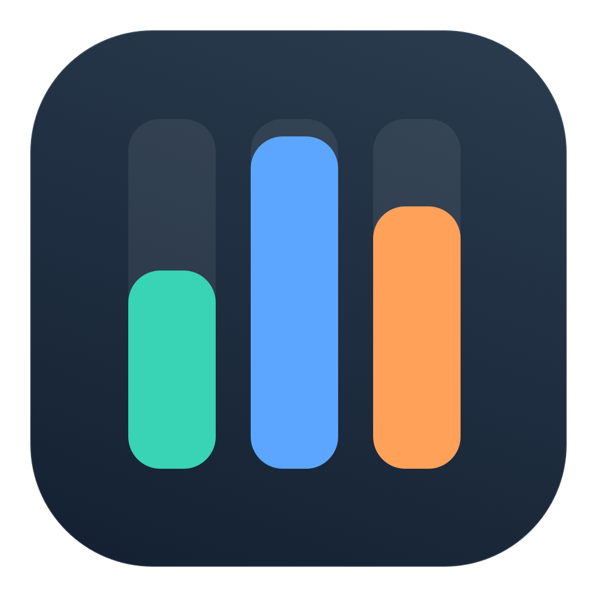
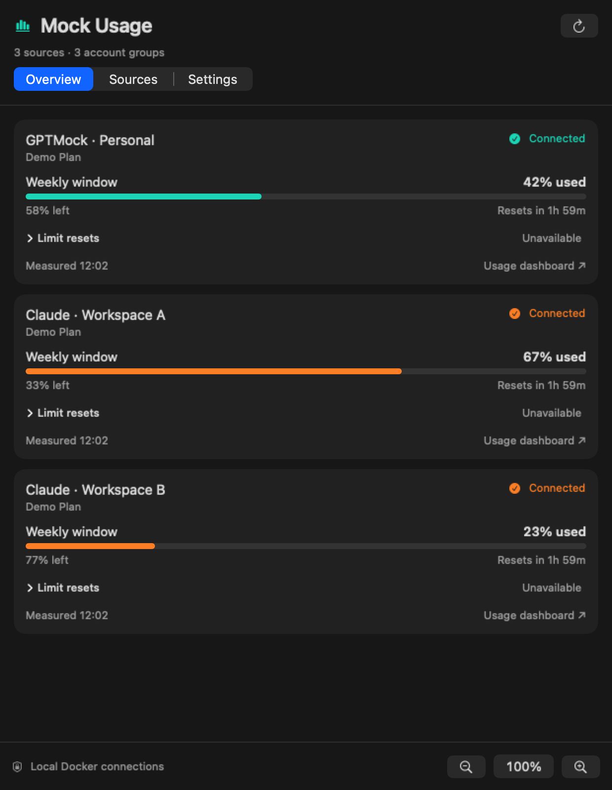
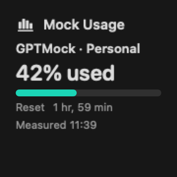
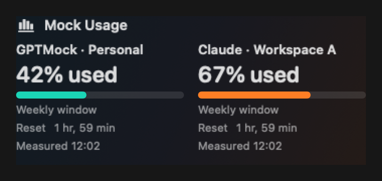
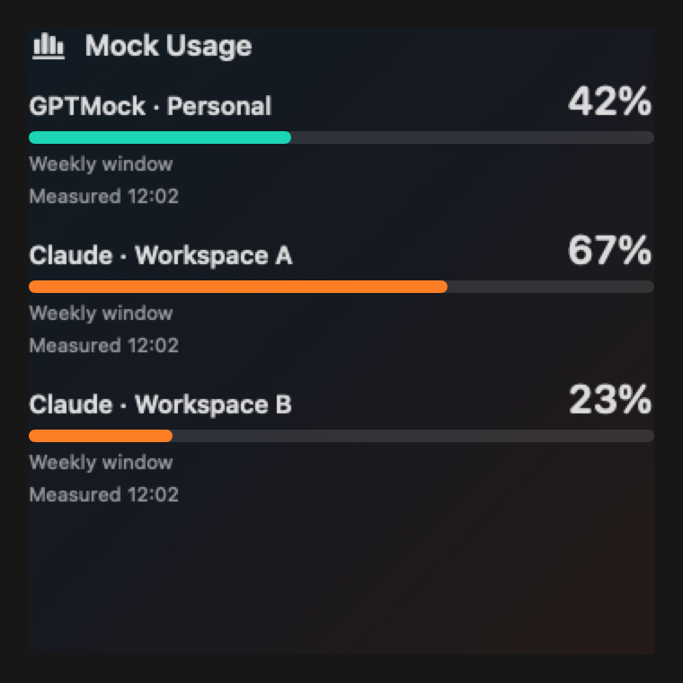
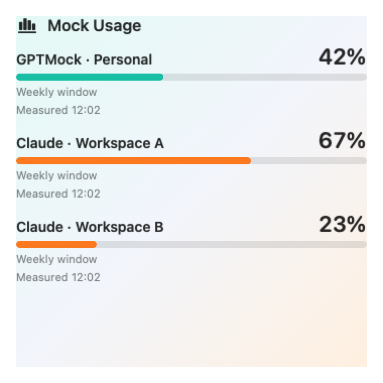
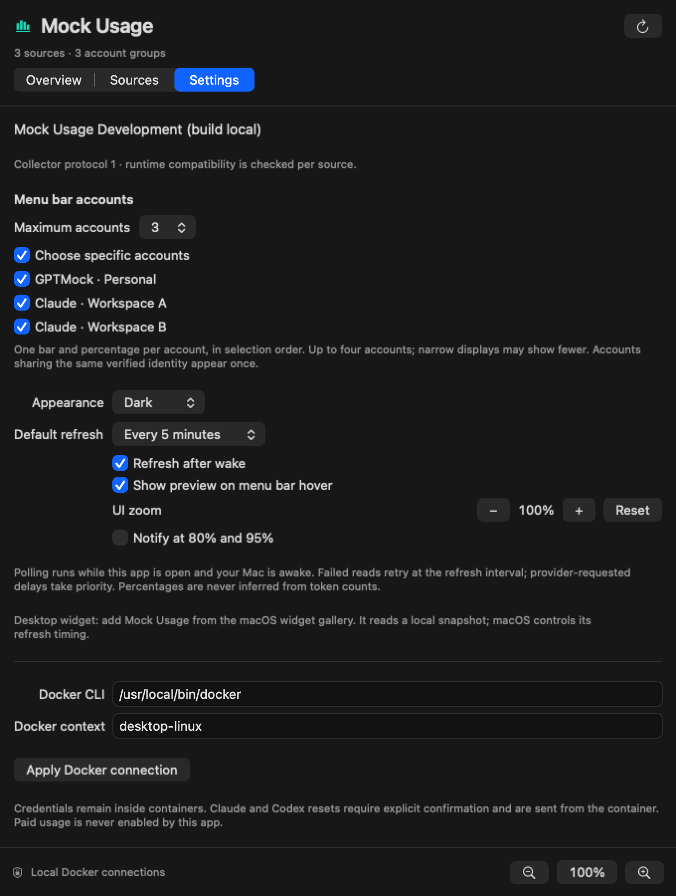

# Mock Usage



A native macOS dashboard, menu bar app and configurable desktop widget for usage limits in locally running **GPTMock** and **Claude Code** Docker containers.

**Version 0.9.1, build 11.** macOS 14 or later. This is an independent local utility, not an official OpenAI or Anthropic app. It reads account usage rather than estimating it from token counts.

## Features

- Account-level quota windows, model-specific limits, remaining allowance and reset times.
- Extra usage, credits and provider offers when supplied by the account.
- Multiple containers, with verified shared account identities grouped into one quota card.
- Editable widgets: small **1 account**, medium **1–2**, large **1–3**.
- Configurable menu bar: **1–4 accounts**, with one matching colored bar and percentage per account. Narrow screens may display fewer.
- Native text zoom, light/dark/system appearance and hover preview.
- Automatic usage refresh and recovery from temporary failures while the app runs, including with the dashboard closed.
- Model availability checked once per connection, then manually in Sources.
- Explicit runtime compatibility and version-bound provider adapters.
- Separately confirmed saved reset actions with validation, duplicate protection and sanitized diagnostics. No reset occurs automatically.

## Install

### From a release archive

1. Extract `MockUsage-<version>-macos-<architecture>.zip`.
2. Move `MockUsage.app` to `~/Applications` (or Applications).
3. Open the app and add your running containers in **Sources**.
4. Add **Mock Usage** from the macOS widget gallery. Right-click a widget and choose **Edit Widget** to select its accounts.

The supplied local build is **ad-hoc signed, not notarized**. Other Macs may require approval in macOS Privacy & Security. Do not disable Gatekeeper globally. For a release that opens without this local-build approval flow, the distributor needs Developer ID signing and notarization. The archive contains no account configuration or credentials.

### Build and install from source

Requirements: full Xcode with its command-line tools selected, XcodeGen, Python 3, and a running Docker engine accessible through the Docker CLI. Swift tests use the installed Xcode toolchain.

```sh
brew install xcodegen
bash scripts/build.sh
bash scripts/install.sh
```

Quit Mock Usage before running the installer. It installs in your user Applications directory, verifies signatures, re-registers the widget extension and stops its old process so macOS loads the new code. Existing application settings are preserved. A new installation starts with **no sources**.

## Connect containers

In **Sources → Add container**, choose GPTMock or Claude Code, select a running container, name the connection and choose its refresh interval. Configure Docker CLI and context in **Settings** if the defaults do not match your installation.

A supported image must include the provider runtime and Python 3, and must already be authenticated as the user used by `docker exec`. **Image names are not a compatibility guarantee**: the app checks the installed runtime version inside each container. Container creation and authentication are separate from this app.

See [supported containers](docs/containers.md) for runtime requirements and examples, and [the user guide](docs/user-guide.md) for all controls.

## Distribution and GitHub

```sh
python3 -m unittest discover -s Tests -v
swift test
python3 scripts/audit-public.py
bash scripts/build.sh
bash scripts/package-release.sh
```

The versioned ZIP and SHA-256 checksum appear in `dist/`; publish these as **GitHub Release assets**, rather than checking build products into source history. The GitHub Actions workflow runs synthetic tests, builds the app and uploads a local-build artifact. It does not publish a release or require provider credentials.

If this repository has private development history, create a fresh public Git repository from the reviewed committed tree:

```sh
bash scripts/export-public.sh
```

The export is under `build/github/MockUsage-<version>`. It has a single clean initial commit, no remote, and no inherited development history. Configure your own remote and push only after reviewing that export. Nothing is automatically uploaded.

## Get the source

```sh
git clone https://github.com/Kubos-ko/MockUsage.git
cd MockUsage
brew install xcodegen
bash scripts/build.sh
bash scripts/install.sh
```

Install full Xcode and Docker Desktop first. A source ZIP can be extracted to a local folder and built with the same commands, omitting `git clone`. Prefer a folder outside iCloud Drive for development. The app starts with no accounts: use Sources to add existing authenticated containers. See [container downloads and validated versions](docs/containers.md).

## Documentation

- [User guide](docs/user-guide.md): sources, widgets, menu bar, usage, resets and troubleshooting.
- [Supported containers](docs/containers.md): image contract and validated versions.
- [Architecture](docs/architecture.md): polling, adapters, storage, widget transport and reset safety.
- [Development and release](docs/development.md): tests, version policy, packaging and deployment.
- [Security](SECURITY.md): credentials, local data and public-source audit.
- [GitHub workflows and security](docs/github.md).
- [Widget restart and background verification](docs/widget-validation.md).
- [Changelog](CHANGELOG.md).

## Limits

The host app must remain running and the Mac awake for new provider reads. WidgetKit controls final widget rendering times; a configured refresh interval is not a delivery guarantee. Provider throttling and authentication expiry can temporarily produce last-known readings. Private provider APIs can change independently of container versions. Unknown runtime versions remain read-only until validated; explicitly unsupported versions are blocked.

Local widgets use the extension's own sandbox snapshot directory without App Groups. This transport has been tested for a local ad-hoc installation; it is not a claim of App Store suitability. No update server, telemetry endpoint or credentials are bundled.

## License

[MIT](LICENSE). Modification, redistribution and commercial use are permitted under its terms.

## UI previews

The following native UI previews use synthetic accounts and invented usage. See [preview generation](docs/images/README.md).










